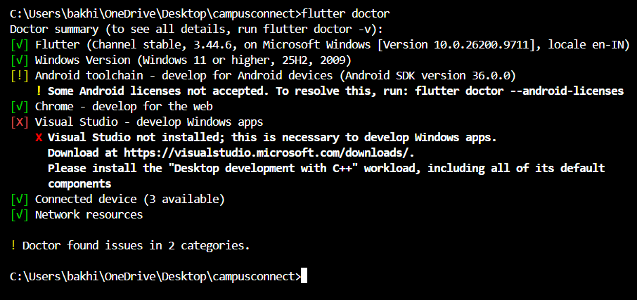
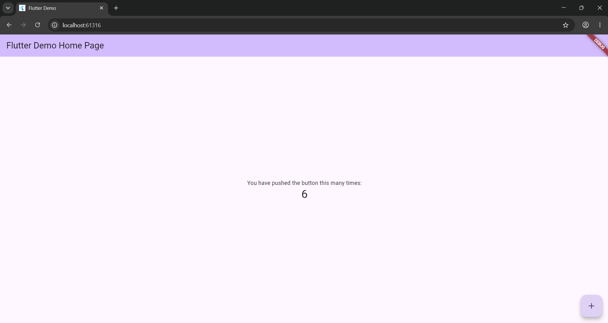
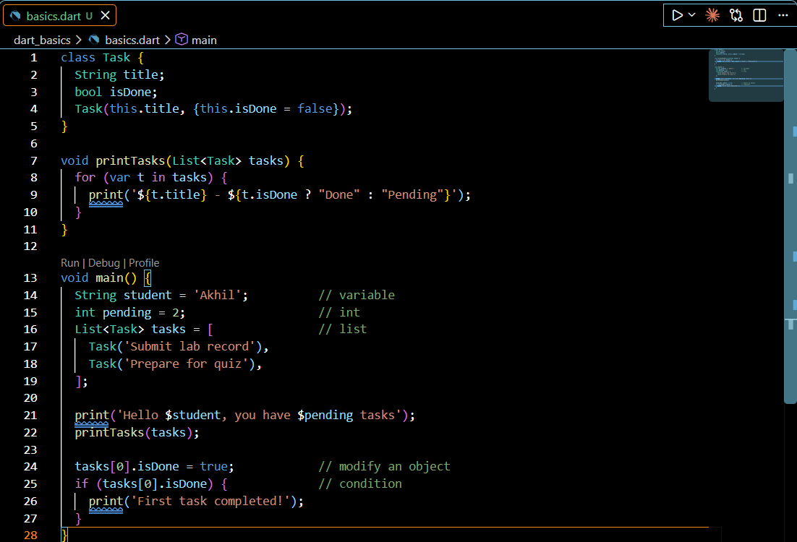
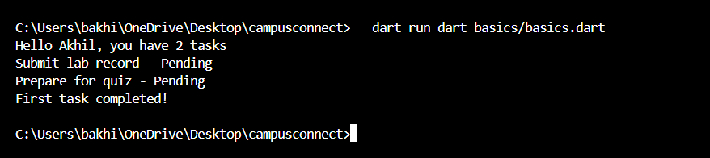
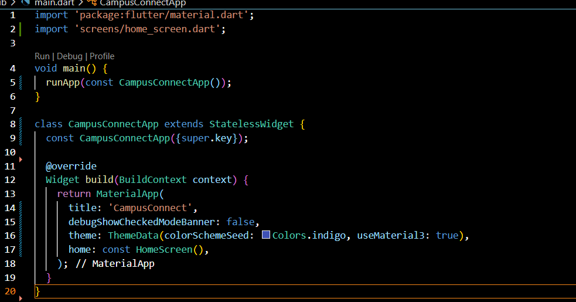
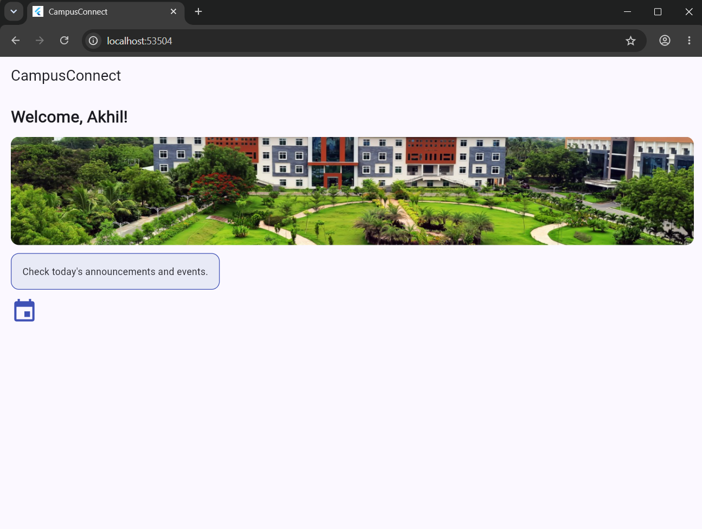
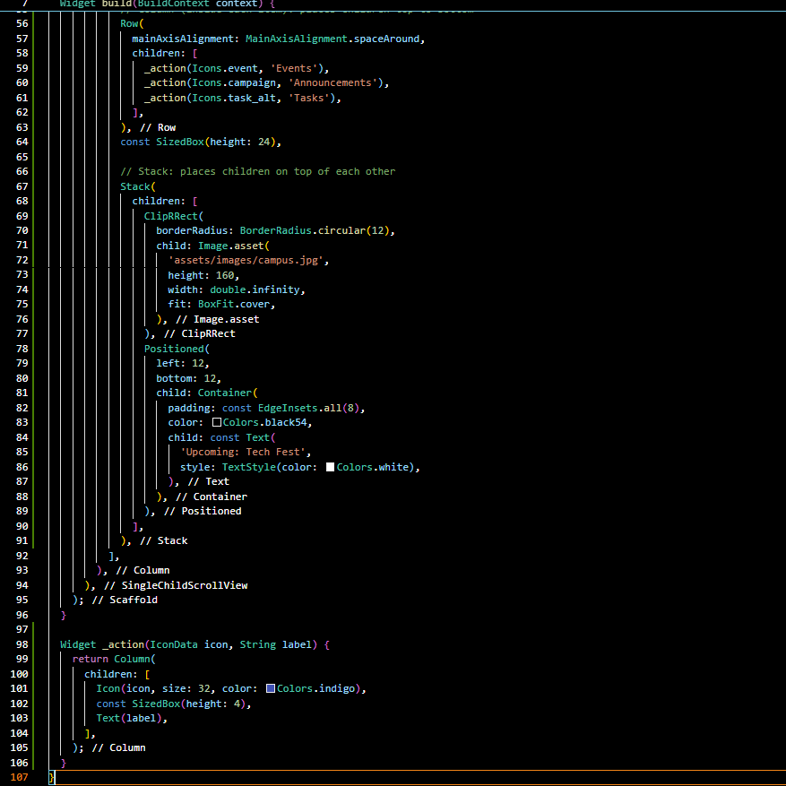
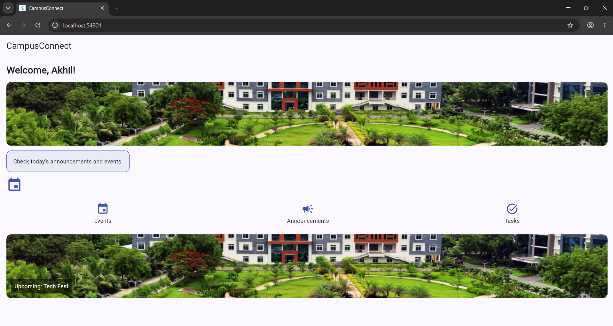

# CampusConnect — Student Companion App

## Abstract

**CampusConnect** is a Flutter-based mobile application designed to simplify everyday student activities by bringing essential features into one place. It provides a simple and user-friendly interface for accessing college events, viewing announcements, and managing personal tasks.

Students can explore upcoming events, check announcements, add and manage tasks, and mark tasks as completed. The application also integrates a REST API to fetch and display dynamic announcement data.

The project demonstrates practical Flutter and Dart concepts, including widgets, responsive layouts, navigation, forms and validation, state management, reusable custom widgets, themes, and animations. Provider is used for state management to maintain a structured and organized application.

CampusConnect is developed as a hands-on learning project to understand how Flutter concepts work together to build a functional mobile application and to establish a foundation for future enhancements.

## Tech Stack

- **Framework:** Flutter
- **Language:** Dart
- **State Management:** Provider
- **API Integration:** REST API

## Getting Started

1. Install [Flutter](https://docs.flutter.dev/get-started/install).
2. Clone this repository.
3. Navigate to the project directory.
4. Install the dependencies:

   ```bash
   flutter pub get
   ```

5. Run the application:

   ```bash
   flutter run
   ```

## Future Enhancements

Additional student-focused features and improvements can be introduced as the project evolves.

## Experiment 1 – Flutter Setup and Dart Basics

### 1a. Flutter and Dart installation
Installed the Flutter SDK (Dart is bundled with it) and verified the setup using `flutter doctor`. Created the project with `flutter create` and ran the default app.




### 1b. Dart basics
`dart_basics/basics.dart` demonstrates variables, data types, a list, a function, a class, a loop and an if condition.




## Experiment 2 – Widgets and Layouts

### 2a. Basic widgets
Used `Text`, `Image`, `Container` and `Icon` on the Home screen (`lib/screens/home_screen.dart`). `Container` is styled with padding, color, border and rounded corners.




### 2b. Layouts using Row, Column and Stack
Used a `Row` of `Column` items for quick actions, and a `Stack` with `Positioned` to place a label over an image.


